> 🏠 **[Main README](../README.en.md)** · 📄 **Report Version:** **Professional Solution Version (EN)** | [Original PDF (ES)](TFM-AgenteOMOP_SergioBermudez_Version-ProfesionalSolucion.pdf) · 🔄 **Companion Report:** [Academic Thesis Version (EN)](TFM-AgenteOMOP_SergioBermudez_Version-MemoriaAcademica.en.md) ([PDF (ES)](TFM-AgenteOMOP_SergioBermudez_Version-MemoriaAcademica.pdf))

<div align="center">


# MASTER'S THESIS
### *Master's Degree in Bioinformatics (2025/2026)*
#### **Professional Solution Version**

---

# OMOP ANALYTICAL AGENT
## CONVERSATIONAL AI APPLICATION TO DEMOCRATIZE DATA ANALYSIS ON OMOP CDM 5.4 CLINICAL DATABASES

**Author:** [Sergio Bermúdez Sánchez](https://www.linkedin.com/in/sergio-bermudez-sanchez/)  
**Supervisor:** Isidoro Gutiérrez Álvarez  

*Villaviciosa de Odón, September 2026*

</div>

---

## Table of Contents

- [Abstract](#abstract)
- [1. Introduction](#1-introduction)
  - [1.1. What is the OMOP CDM (OHDSI)?](#11-what-is-the-omop-cdm-ohdsi)
  - [1.2. What is Conversational AI Analytics?](#12-what-is-conversational-ai-analytics)
  - [1.3. Proof of Concept: The 'OMOP Analytical Agent'](#13-proof-of-concept-the-omop-analytical-agent)
    - [1.3.1. Example Questions to be Answered by the 'OMOP Analytical Agent'](#131-example-questions-to-be-answered-by-the-omop-analytical-agent)
- [2. Hypothesis and Objectives](#2-hypothesis-and-objectives)
  - [2.1. Hypothesis](#21-hypothesis)
  - [2.2. Objectives](#22-objectives)
    - [2.2.1. Specific Objectives](#221-specific-objectives)
    - [2.2.2. Sustainable Development Goals (SDGs)](#222-sustainable-development-goals-sdgs)
- [3. Materials and Methods](#3-materials-and-methods)
  - [3.1. Functional Schema and Technical Architecture of the Agent](#31-functional-schema-and-technical-architecture-of-the-agent)
    - [3.1.1. Functional Schema of Agents and Subagents](#311-functional-schema-of-agents-and-subagents)
    - [3.1.2. Technical Architecture](#312-technical-architecture)
    - [3.1.3. Access to the OMOP Agent](#313-access-to-the-omop-agent)
    - [3.1.4. Source Code](#314-source-code)
  - [3.2. Results Evaluation Methodology](#32-results-evaluation-methodology)
    - [3.2.1. Qualitative Evaluation (Functional Demonstration of the Agent)](#321-qualitative-evaluation-functional-demonstration-of-the-agent)
    - [3.2.2. Quantitative Evaluation](#322-quantitative-evaluation)
      - [Evaluation Dataset](#evaluation-dataset)
      - [Evaluation Metrics](#evaluation-metrics)
      - [Evaluation Procedure](#evaluation-procedure)
- [4. Results](#4-results)
  - [4.1. Qualitative Results](#41-qualitative-results)
    - [4.1.1. Example 1: Analytical Query (Diabetes)](#411-example-1-analytical-query-diabetes)
    - [4.1.2. Example 2: Terminological Mapping and Extraction (Dementia)](#412-example-2-terminological-mapping-and-extraction-dementia)
  - [4.2. Quantitative Results](#42-quantitative-results)
    - [4.2.1. Results by Complexity Level](#421-results-by-complexity-level)
    - [4.2.2. Results by OMOP CDM Domain](#422-results-by-omop-cdm-domain)
    - [4.2.3. Results by Complexity Level and Resolution Turn](#423-results-by-complexity-level-and-resolution-turn)
    - [4.2.4. Effect of Iterative Refinement](#424-effect-of-iterative-refinement)
- [5. Discussion](#5-discussion)
  - [5.1. Prompt Improvement](#51-prompt-improvement)
    - [5.1.1. Improvements to Implement in the OMOP Agent Instructions](#511-improvements-to-implement-in-the-omop-agent-instructions)
    - [5.1.2. Expected Operational Benefit and Impact](#512-expected-operational-benefit-and-impact)
  - [5.2. Limitations in Evaluating Vocabulary Precision](#52-limitations-in-evaluating-vocabulary-precision)
  - [5.3. Limitations Identified for Production Deployment](#53-limitations-identified-for-production-deployment)
- [6. Conclusions and Potential Future Developments](#6-conclusions-and-potential-future-developments)
  - [6.1. Conclusions](#61-conclusions)
  - [6.2. Potential Future Developments](#62-potential-future-developments)
- [7. References](#7-references)
- [8. Annexes](#8-annexes)

<details>
<summary><strong>📊 Index of Figures and Tables</strong></summary>

**Figures**
- [Figure 1. OMOP Common Data Model adoption](#figure-1)
- [Figure 2. OMOP Common Data Model standardized schema](#figure-2)
- [Figure 3. Orchestrator agent and subagents](#figure-3)
- [Figure 4. Interaction flow between the agents and the user](#figure-4)
- [Figure 5. Technical architecture](#figure-5)
- [Figure 6. Example of a "Gold Standard" query definition](#figure-6)
- [Figure 7. Example of an evaluation result](#figure-7)
- [Figure 8. Interaction with the OMOP agent: Medical concept identification](#figure-8)
- [Figure 9. Interaction with the OMOP agent: Generation of validated SQL and decision explanation](#figure-9)
- [Figure 10. Interaction with the OMOP agent: Response improvement based on user request](#figure-10)
- [Figure 11. Interaction with the OMOP agent: Search for the closest OMOP codes to the medical concept](#figure-11)
- [Figure 12. Distribution of OMOP Agent Performance by Complexity Level](#figure-12)
- [Figure 13. Mean Performance of the Agent by Primary OMOP CDM Domain](#figure-13)
- [Figure 14. Conversational Effort Required by Query Complexity (N = 201)](#figure-14)
- [Figure 15. Trajectory of result improvement across conversational turns](#figure-15)
- [Figure 16. Cumulative Efficacy Curve of Conversational Refinement (N = 201)](#figure-16)

**Tables**
- [Table 1. Overall Descriptive Statistics of Agent Performance (N = 201)](#table-1)
- [Table 2. Comparative Performance by Complexity Level](#table-2)
- [Table 3. Agent Performance Stratified by Primary OMOP Domain](#table-3)
- [Table 4. Contingency Table: Complexity Level × Executed Conversational Turns](#table-4)
- [Table 5. Performance Progression and Net Gain (Delta) by Turn](#table-5)

</details>

---

## Abstract

Access to standardized health data under the **OMOP CDM** common data model remains limited by the need for advanced technical knowledge in SQL and familiarity with the structure and hierarchies of OHDSI vocabularies. To overcome this barrier, in this Master's Thesis I developed the **OMOP Analytical Agent**, a conversational AI-based proof of concept that enables healthcare professionals and researchers to formulate analytical characterization and incidence questions in natural language.

The solution was implemented using a **multi-agent architecture** built on the **ADK (Agent Development Kit) framework**. The underlying model used is `Gemini-2.5-flash`—although the system is model-agnostic and allows replacement—and is supported by a RAG (*Retrieval-Augmented Generation*) system for medical synonym search, making it easier to locate the official codes (SNOMED CT, RxNorm) required by OMOP within a purpose-built database. The system delegates work across specialized subagents for terminological search, code validation, SQL construction, and syntactic verification.

To evaluate the solution, I created an *ad-hoc* test dataset comprising 201 questions classified by SQL complexity (low, intermediate, complex) and by primary domains (`condition`, `measurement`, `concept_relationship`, etc.). The results obtained show a first-turn **Syntactic and Structural Validity** of the SQL of **23.9%**, reaching an overall mean of **84.9%** when interacting 2 or 3 times with the agent to help refine its response. Evaluation of **Vocabulary Terminological Precision** achieved a remarkably high **92.5%**, with 90.0% perfect assignments—a result that may very well be influenced by the fact that the evaluation dataset did not exhibit extreme complexity along this dimension.

These results confirm the agent's strong effectiveness in resolving standardized medical concepts, while highlighting the challenges of generating SQL for complex queries involving multiple joins. Overall, the project demonstrates the feasibility of using conversational agents to democratize observational data analysis (SDGs 3, 4, 9, and 10), while identifying clear opportunities for further tool improvement.

---

## 1. Introduction

How many clinicians and researchers can directly analyze data sources within their own organizations (Primary or Secondary Care, etc.) without possessing technical expertise in databases?

How can healthcare professionals obtain answers to questions such as the following?

- Among patients newly diagnosed with atrial fibrillation, how many receive a warfarin prescription?
- What is the average age of patients undergoing hip arthroplasty?
- What is the incidence rate of pneumonia in patients over 65 years of age?

Depending on the capabilities of the organization and/or the user, answering these questions is typically handled in one of three ways:

1. The organization has a Business Intelligence (BI) tool with reports specifically designed to answer the question in mind (e.g., Power BI, Tableau, OHDSI-Atlas, etc.), and the user has the necessary training to operate them.
2. The organization has a clinical bioinformatics team that can provide the user with either the final answer or summary tables for further analysis using spreadsheets or other analytical tools (R/Python/etc.).
3. The user possesses the technical knowledge (primarily the clinical database schema) to interact directly (via SQL or another language) with the database (which requires access permissions), while avoiding the extraction of Personally Identifiable Information (knowledge of PII / GDPR).

Consequently, current solutions are not serving all potential users.

### 1.1. What is the OMOP CDM (OHDSI)?

The *Observational Medical Outcomes Partnership* (OMOP) *Common Data Model* (CDM) is an open community data standard, supported by the OHDSI (*Observational Health Data Sciences and Informatics*) community, designed to standardize the structure and content of observational data and enable efficient analyses that produce reliable evidence.

<a id="figure-1"></a>
<div align="center">

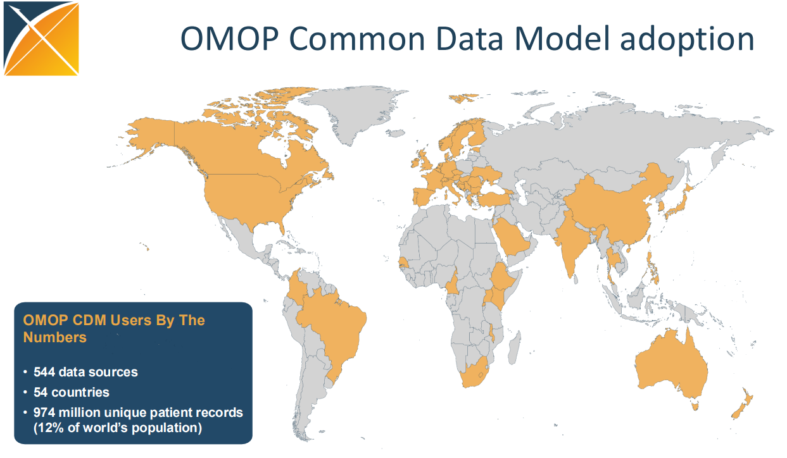

*Figure 1. Taken from State of the OHDSI community (p. 16), by G. Hripcsak, 2025, Observational Health Data Sciences and Informatics (https://www.ohdsi.org/wp-content/uploads/2025/10/OHDSI2025-Hripcsak-State-of-Community.pdf).*

</div>

In summary, OMOP is a common clinical database schema design adopted by 544 Health Data Partners across 54 countries, encompassing 974 million Unique Patient Records (2025), and serves as the foundation for collaborative health analysis (for example, the European EHDEN network) in clinical and healthcare settings.

<a id="figure-2"></a>
<div align="center">

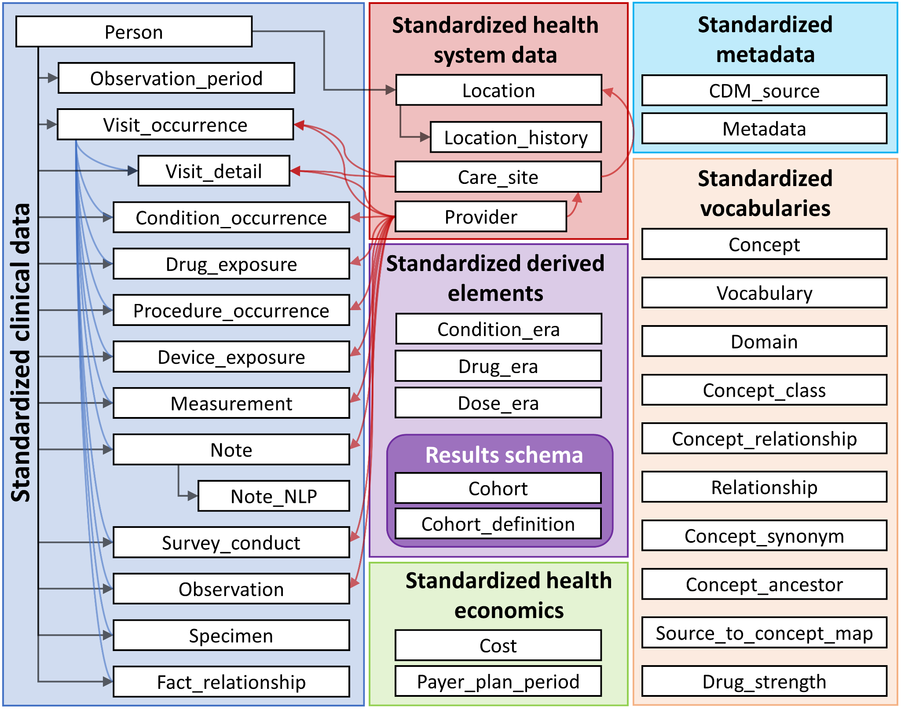

*Figure 2. Note. Adapted from Data standardization: OMOP Common Data Model, by Observational Health Data Sciences and Informatics (OHDSI), n.d. (https://www.ohdsi.org/data-standardization/).*

</div>

### 1.2. What is Conversational AI Analytics?

Conversational AI is a branch of artificial intelligence (AI) capable of simulating human conversation. It is made possible by Natural Language Processing (NLP), a field of AI that enables computers to understand and process human language.

Conversational Analytics (CA) is an emerging field of AI that specifically applies natural language processing to extract analytical insights from databases or data warehouses, enabling non-technical users to ask questions about metrics, search, and numerical data visualization.

### 1.3. Proof of Concept: The 'OMOP Analytical Agent'

The primary objective of this work has been to build an agent based on applying Conversational AI Analytics technology to the *Observational Medical Outcomes Partnership* (OMOP) *Common Data Model* (CDM). Specifically, what we aim to build is:

- An agent that enables healthcare users who are not database experts to formulate analytical questions in natural language against data sources using the OMOP Common Data Model.
- By default, the agent locates the relevant OMOP codes based on the description of the disease, diagnosis, medication, or any other clinical concept, and provides the SQL query so the user can interact with their own OMOP environment.

#### 1.3.1. Example Questions to be Answered by the 'OMOP Analytical Agent'

- Among patients newly diagnosed with atrial fibrillation, how many receive a warfarin prescription?
- What is the average age of patients undergoing hip arthroplasty?
- What is the incidence rate of pneumonia in patients over 65 years of age?

Focusing primarily on characterization questions formulated such as:

- How many patients...?
- How frequently...?
- What proportion of patients...?
- What are the laboratory values for patients...?
- What is the mean duration of exposure in patients with...?
- What are the trends over time in...?
- What other medications are these patients taking?

---

## 2. Hypothesis and Objectives

### 2.1. Hypothesis

The implementation of an LLM (*Large Language Model*)-based analytical agent integrated with the OMOP *Common Data Model* (CDM) will enable healthcare professionals without technical knowledge of SQL or database schemas to obtain accurate answers and clinical characterization results using natural language.

This solution will overcome current barriers to information access in healthcare organizations that use the OMOP standard and rely on specialized bioinformatics teams or complex BI tools to answer straightforward clinical questions.

### 2.2. Objectives

To develop a conversational agent capable of interacting with databases compliant with the OMOP CDM standard to execute, in an automated manner, cohort characterization and incidence analysis queries.

#### 2.2.1. Specific Objectives

- **Adapt OMOP Metadata:** Modify and enrich the existing metadata schema so that it is interpretable by an AI agent framework.
- **Integrate Standard Vocabularies:** Implement a vocabulary search engine (such as SNOMED, ICD-10, etc.) to validate clinical concepts and synonyms during the conversation.
- **Automated SQL Generation:** Develop the capability to translate natural language into valid SQL queries for the OMOP schema, using existing query libraries as a reference.

#### 2.2.2. Sustainable Development Goals (SDGs)

##### SDG 10: Reduced Inequalities
The primary premise of the agent is to democratize access to observational data. Currently, there is a wide gap and deep inequality between medical institutions with large budgets and specialized bioinformatics teams and healthcare centers or researchers with limited resources.

By providing interactive natural language software, any healthcare professional or institution—regardless of technical resources or analytical budget—can leverage the potential of the global data network based on the OMOP standard.

##### SDG 4: Quality Education
The project directly contributes to data literacy in the healthcare sector. By integrating a conversational system that translates natural language into complex structured queries (SQL over OMOP CDM) and equipping it with standard vocabulary search engines (SNOMED, ICD-10), the tool also serves as a learning bridge.

It enables researchers and clinical staff without technical database training to intuitively and didactically understand the hierarchies of medical terms and the structure of international clinical information.

##### SDG 9: Industry, Innovation and Infrastructure
With utilities like the OMOP Agent, reliance on rigid analytical tools or bioinformatics teams overloaded with simple queries submitted by medical staff can be significantly reduced.

##### SDG 3: Good Health and Well-being
The agent empowers healthcare professionals (physicians, epidemiologists, health managers) to extract critical insights and run clinical characterization and incidence studies immediately and without technical barriers. This accelerates evidence-based medical decision-making, enabling faster diagnoses and more efficient epidemiological monitoring during health crises.

---

## 3. Materials and Methods

### 3.1. Functional Schema and Technical Architecture of the Agent

The agent requires two complementary designs: first, a functional design specifying the tasks of each subagent and how the orchestrator uses each subagent's outputs to present the final result to the user; and second, a technical design of the technological components (databases, code, etc.) required for this development.

#### 3.1.1. Functional Schema of Agents and Subagents

<a id="figure-3"></a>
<div align="center">

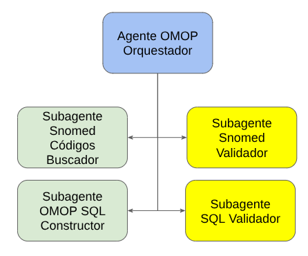

*Figure 3. Orchestrator agent and subagents.*

</div>

The system is composed of 5 agents specialized in specific tasks, described below:

- **OMOP Orchestrator Agent (*Agente OMOP Orquestador*):** The central node and entry point. Its primary function is to decompose the received medical query into subtasks and dispatch them to the subagents. Upon receiving the subagents' responses, it generates the final reply.
- **SNOMED Code Searcher Subagent (*Subagente Snomed Códigos Buscador*):** Responsible for extracting "official" clinical entities (`concept_id` values). It searches directly for the concept described by the user in the databases; if not found, it generates synonyms by searching the RAG database and queries the database again. It returns the discovered codes to the main agent.
- **SNOMED Validator Subagent (*Subagente Snomed Validador*):** Acts as a control mechanism to verify that the response is accurate. The `concept_id` values must originate from database lookups rather than from the agent's pre-trained weights. Its main goal is to eliminate model "hallucinations" and prevent the agent from offering codes fabricated from its own training data.
- **OMOP SQL Constructor Subagent (*Subagente OMOP SQL Constructor*):** Responsible for translating the user's request into a SQL statement. It inspects the OMOP database model ([Figure 2](#figure-2)) and iterates on building the SQL until returning an initial proposal.
- **SQL Validator Subagent (*Subagente SQL Validador*):** Arguably one of the most critical components of the system, as it checks directly against a live OMOP database that the SQL executes properly. If syntactic, field, or table errors are found, it returns the error to the SQL Constructor agent so it can provide an alternative. This loop repeats until the SQL is 100% valid.

The communication workflow among the agents operates as follows:

<a id="figure-4"></a>
<div align="center">

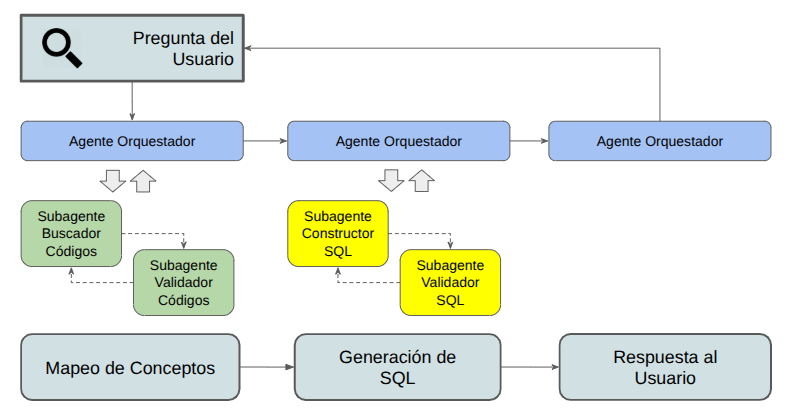

*Figure 4. Interaction flow between the agents and the user.*

</div>

Upon receiving the user's question, the orchestrator agent first assigns the task of identifying codes for all medical concepts appearing in the question. The two code subagents (searcher and validator) interact with each other until they accurately locate the involved `concept_id` values and return them to the orchestrator.

Holding those codes in memory, the orchestrator passes them to the SQL constructor subagent, which generates candidate queries that are validated by the SQL validator subagent. These two subagents likewise iterate until the SQL is fully validated and returned to the orchestrator.

Finally, the orchestrator presents the SQL to the user alongside a clause-by-clause explanation of what each part of the SQL does, enabling the user to better interpret the result and request modifications to the SQL if desired.

#### 3.1.2. Technical Architecture

<a id="figure-5"></a>
<div align="center">

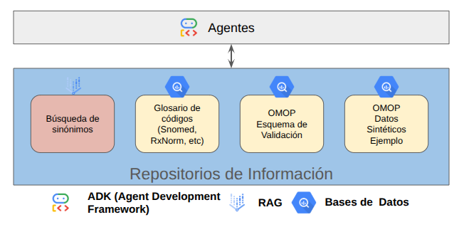

*Figure 5. Technical architecture.*

</div>

The entire system was developed on the Google Cloud platform using the following core technical components:

- **Agents:** Developed using the ADK (*Agent Development Kit*) framework following the workflow explained above, and deployed using Docker via Cloud Build into a web test environment on Google Cloud Run. The model used inside the agents is `Gemini 2.5 flash`, although the framework is model-agnostic and could be switched to any other model.
- **RAG System (*Retrieval-Augmented Generation*):** The vector search engine that retrieves the most relevant matches based on the medical text entered by the user. The technical component used is Google Cloud Vertex AI Search.
- **Databases / Persistence Layer:** The datasets (collections of tables) used by the subagents to query and validate information. All three databases are hosted in Google Cloud BigQuery:
  - **Glossary of Terms:** Repository containing the standardized vocabularies of the OMOP system.
  - **OMOP Validation Schema:** A metadata and schema structure used by the validator to confirm that the designed SQL adheres to the rules of the model.
  - **OMOP Synthetic Sample Data:** An OMOP database populated with simulated patient data against which final queries are executed and results extracted.

#### 3.1.3. Access to the OMOP Agent

The agent is accessible and operational at the following link:

- [Agent Development Environment (Access upon request)](https://omop-agent-dev-995233896922.europe-west1.run.app/dev-ui/?app=omop_03_concepts_and_sql)

#### 3.1.4. Source Code

The GitHub repository includes the agent source code, the evaluation code, and the thesis annexes:

- https://github.com/sogire/tfm-ue-bioinformatica2526-agente-omop

---

### 3.2. Results Evaluation Methodology

To evaluate the effectiveness, precision, and reliability of the multi-agent system, I designed an experimental framework structured into two complementary phases:

1. **Qualitative Evaluation:** Focused on demonstrating the proper operational and interactive behavior of the agent across queries of varying nature.
2. **Quantitative Evaluation:** Designed to objectively measure terminological precision, SQL syntax validity, and the accuracy of retrieved data.

#### 3.2.1. Qualitative Evaluation (Functional Demonstration of the Agent)

This first phase aims to qualitatively validate the interaction flow, the orchestrator agent's ability to coordinate subagents, and the clarity of the results presented to the user. Through this analysis, the agent is shown to be functional and capable of answering real-world questions in natural language.

- **Example 1: Analytical Query (Diabetes)**
  - **User question:** *"Genera una SQL para visualizar el número de pacientes con diabetes por años"* ("Generate a SQL query to visualize the number of patients with diabetes by year")
  - **Agent workflow:**
    1. Identifies and validates the most relevant standardized concept: `201820`: *Diabetes mellitus* (SNOMED).
    2. Constructs and validates the SQL statement grouped by year.
    3. Returns the structured SQL query together with a step-by-step didactic explanation of each clause (`SELECT`, `FROM`, `WHERE`, `GROUP BY`, `ORDER BY`).
    4. Iterates on the response to further refine the SQL.

- **Example 2: Terminological Mapping and Extraction (Dementia)**
  - **User question:** *"Genera un listado de los principales códigos para analizar la demencia."* ("Generate a list of the main codes to analyze dementia.")
  - **Agent workflow:** The vocabulary search and validation subagent extracts related concepts from the metadata database, structuring them into an ordered table with their OMOP `concept_id`, concept name, and source SNOMED code.

#### 3.2.2. Quantitative Evaluation

This second phase carried out a systematic validation over a controlled dataset. The goal is not only to obtain an overall quantification of the system, but also to pinpoint the specific scenarios where the system requires improvement.

##### Evaluation Dataset

The evaluation dataset, referred to as the *Gold Standard* ([Annex C](#8-annexes)), consists of 201 clinical questions in Spanish formulated in natural language and paired with their corresponding reference SQL queries. These queries are categorized according to their primary clinical domain in OMOP CDM 5.4 (for example, `condition`, `measurement`, or `concept_relationship`) and their syntactic complexity level: **low** (direct queries or simple catalog joins), **intermediate** (multiple joins, aggregations, or subqueries), and **complex** (CTE expressions, window functions, or advanced nested subqueries).

To construct this benchmark *ad hoc*, the standardized queries from the OHDSI community's *QueryLibrary* were used as reference.

**Example of a question to evaluate:** *"Listar todas las condiciones y enfermedades clínicas cuya localización anatómica corresponda al concepto 4103720 (articulación de la rodilla)"* ("List all clinical conditions and diseases whose anatomical site corresponds to concept 4103720 (knee joint)"). Below is the example specification card:

<a id="figure-6"></a>
```yaml
## Example Gold Standard Question Card ##

id_evaluacion: "querylibrary_C11"
nivel_complejidad: "intermedia"
domain_main: "concept"
domain_others: "concept_relationship"
pregunta_lenguaje_natural: >-
  Listar todas las condiciones y enfermedades clínicas cuya localización
  anatómica corresponda al concepto 4103720 (articulación de la rodilla).
sql_base_gold_standard: |
  SELECT
    a.concept_id       AS condition_id,
    a.concept_name     AS condition_name,
    a.concept_code     AS condition_code,
    a.concept_class_id AS condition_class,
    a.vocabulary_id    AS condition_vocab_id,
    d.concept_id       AS anatomical_site_id,
    d.concept_name     AS anatomical_site_name,
    d.concept_code     AS anatomical_site_code,
    d.concept_class_id AS anatomical_site_class,
    d.vocabulary_id    AS anatomical_site_vocab_id
  FROM `bio-med-480108.OMOP_54_A.concept_relationship` AS cr
    JOIN `bio-med-480108.OMOP_54_A.concept` AS a ON cr.concept_id_1 = a.concept_id
    JOIN `bio-med-480108.OMOP_54_A.concept` AS d ON cr.concept_id_2 = d.concept_id
  WHERE
    cr.relationship_id = 'Has finding site' AND
    d.concept_id = 4103720 AND
    cr.invalid_reason IS NULL
  ;
concept_ids_gold_standard: "4103720"
```
<div align="center">

*Figure 6. Example of a "Gold Standard" query definition.*

</div>

##### Evaluation Metrics

Validation is performed using a multidimensional approach to evaluate the distinct characteristics of a response:

1. **Syntactic and Structural Validity:** Measures the percentage of SQL queries generated by the agent that are syntactically valid and executable without error in the database engine.
   - *Metric:* Ratio of Valid SQL queries over total evaluated SQL queries.
2. **Vocabulary Terminological Precision:** Evaluates the percentage of standardized identifiers (`concept_id` from SNOMED CT, RxNorm, etc.) correctly identified by the subagents and the RAG system.
   - *Metric:* Ratio of correctly identified `concept_id` values over total concepts to be identified in the query.

##### Evaluation Procedure

I built a Python script, included in the repository and annexes, that follows the workflow below for each record:

1. **Invocation:** The natural language question is sent to the OMOP Agent.
2. **Execution and Extraction:** Logging of the SQL produced by the agent.
3. **SQL Syntax Check** and recording of the Syntactic and Structural Validity (VSE / SSV) metric.
4. **Verification and recording** of the 'Vocabulary Terminological Precision' metric.
5. **Iterative Refinement:** If the response is not satisfactory on the first iteration (Turn 1), follow-up interaction continues sequentially up to Turn 3, the evaluation limit.
6. **Consolidation:** Tabulation of execution results and runtime errors.

**Example of an evaluation result:**

<a id="figure-7"></a>
```yaml
id_evaluacion: querylibrary_C11
session_id: 2e03cfd2-498e-4aba-90cb-ea989fa56588
session_file: sessions/C11.json
turnos_ejecutados: 1
sql_generada_agente: |-
  SELECT c.concept_id,
         c.concept_name,
         c.domain_id
  FROM `bio-med-480108.omop_54_a.concept` c
    JOIN `bio-med-480108.omop_54_a.concept_ancestor` ca ON c.concept_id = ca.descendant_concept_id
  WHERE ca.ancestor_concept_id = 4103720
    AND c.domain_id = 'Condition'
    AND c.standard_concept = 'S'
concept_ids_identificados_agente:
  - 4103720
metricas_evaluacion:
  validez_sintactica_y_estructural: 1.0
  precision_terminologica_vocabulario: 1.0
  metricas_por_turno:
    turno_1:
      validez_sintactica_y_estructural: 1.0
      precision_terminologica_vocabulario: 1.0
      question_improvement: ''
evaluacion_cualitativa: |-
  Direct generation of a valid SQL query over table(s) CONCEPT,
  CONCEPT_ANCESTOR in a single turn with successful validation in BigQuery.
  Optimal terminological precision: identified and used all required
  concepts ([4103720]).
check_conexion: true
```
<div align="center">

*Figure 7. Example of an evaluation result.*

</div>

To conduct a rigorous and reproducible evaluation of the analytical agent, I developed an automated testing framework named [`tfm-eval`](../evaluacion-agente-omop-03/README.en.md), included in the project's GitHub repository. This system uses Python scripts ([`run_query_evaluation.py`](../evaluacion-agente-omop-03/scripts/execute_evaluation/run_query_evaluation.py) and [`analyze_evaluation_results.py`](../evaluacion-agente-omop-03/scripts/execute_evaluation/analyze_evaluation_results.py)) that interact directly with the OMOP agent hosted on Google Cloud Run.

This infrastructure captures agent responses in real time, logs internal tool usage, and saves a complete session history to analyze performance and compute metrics.

The evaluation process follows a progressive dialogue protocol of up to three turns to guide the agent when a query requires clarification. In **Turn 1**, the medical question in Spanish is submitted requesting a valid SQL query for OMOP CDM 5.4, and the initial codes or concepts proposed by the system are confirmed. If the agent does not generate the code immediately, the evaluator proceeds to **Turn 2**, formally confirming the identified concepts and including information about the involved tables or domains (`domain_main` and `domain_others`). Finally, if the agent still has not returned the query, in **Turn 3** it is directly instructed to output solely the final `SELECT` statement ready for execution.

---

## 4. Results

### 4.1. Qualitative Results

#### 4.1.1. Example 1: Analytical Query (Diabetes)

<a id="figure-8"></a>
<div align="center">


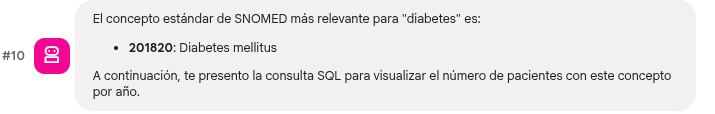

*Figure 8. Interaction with the OMOP agent: Medical concept identification.*

</div>

The system accurately locates and identifies the condition in the SNOMED vocabulary and returns the OMOP code to be used in the subsequent query.

<a id="figure-9"></a>
<div align="center">

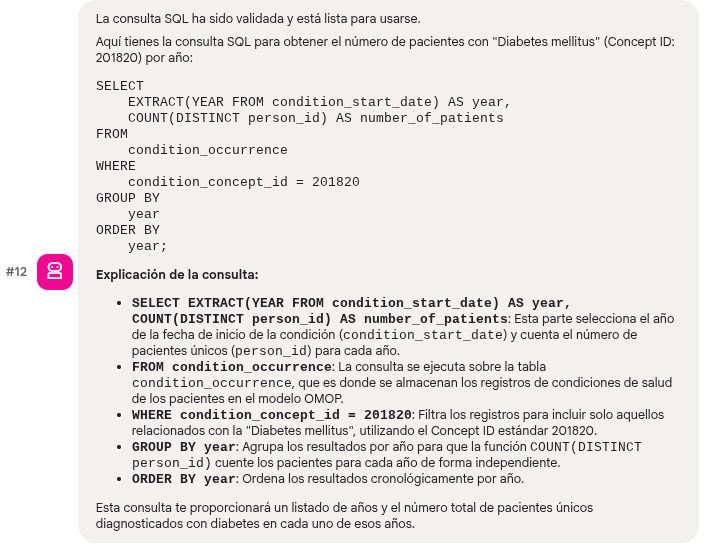

*Figure 9. Interaction with the OMOP agent: Generation of validated SQL and decision explanation.*

</div>

Next, it generates a SQL query that is validated and functional because it has been tested against a live database. It also attaches an explanation of the generated SQL so that the clinician or user can verify that the data it will return is indeed what they intended to retrieve. This explanation is essential to allow the clinician or user to iteratively refine the query through subsequent interactions.

For instance, when we request that it extract not only the aforementioned concept but also all of its descendants, the agent responds with a fully accurate and re-validated SQL modification:

<div align="center">


</div>

<a id="figure-10"></a>
<div align="center">

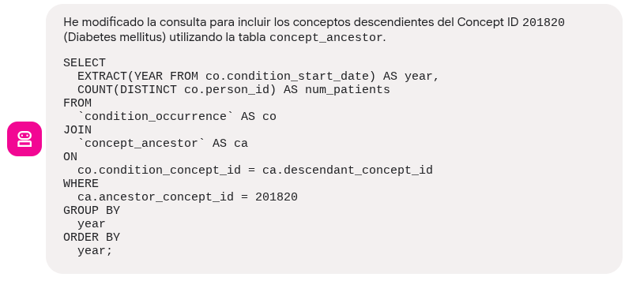

*Figure 10. Interaction with the OMOP agent: Response improvement based on user request.*

</div>

#### 4.1.2. Example 2: Terminological Mapping and Extraction (Dementia)

<a id="figure-11"></a>
<div align="center">


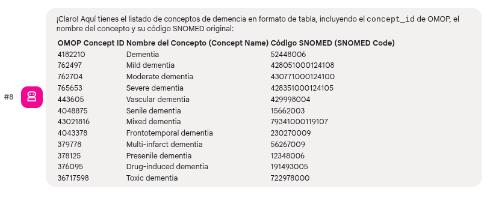

*Figure 11. Interaction with the OMOP agent: Search for the closest OMOP codes to the medical concept in the user's question.*

</div>

The vocabulary search and validation subagent extracts an initial set of top matching examples that correspond to the requested clinical concept.

**Demonstration video of the agent in operation:** [Link to Online Video](https://drive.google.com/file/d/1X5LAdfPPc92Amx8OGB7D8k7gLjz-4G9q/view?usp=sharing) ([Local Video File](Anexo-A_TFM_AgenteOMOP_Video-Demostracion.mp4))

---

### 4.2. Quantitative Results

The final *Gold Standard* benchmark used consists of 201 test questions classified by complexity level: 26 low-complexity questions, 71 intermediate-complexity questions, and 104 high-complexity questions.

[Table 1](#table-1) reports the overall descriptive statistics obtained after the complete evaluation protocol. Overall results show a solid **Syntactic and Structural Validity** with a mean of $0.849$ ($\pm 0.271$) and a median of $0.950$, highlighting a high mean SQL executability of $0.094$ out of $0.10$ and a structural similarity of $0.756$ out of $0.90$. Likewise, **Vocabulary Terminological Precision** achieved a high mean of $0.925$ ($\pm 0.239$) with a median of $1.000$, requiring an average of $2.100$ executed conversational turns (with a median of $2.0$ turns) to reach these performance levels.

<a id="table-1"></a>
**Table 1.** *Overall Descriptive Statistics of Agent Performance ($N = 201$).*

| Evaluated Metric | N | Mean ± SD | Median [IQR] | Min – Max | 95% CI Mean |
| :--- | :---: | :---: | :---: | :---: | :---: |
| **Syntactic and Structural Validity (Final)** | 201 | 0.849 ± 0.271 | 0.950 [0.130] | 0.00 – 1.00 | [0.811 – 0.887] |
| ↳ Criterion 1.1: SQL Executability (Max. 0.10) | 201 | 0.094 ± 0.025 | 0.100 [0.000] | 0.00 – 0.10 | [0.090 – 0.097] |
| ↳ Criterion 1.2: Gold Standard Structural Similarity (Max. 0.90) | 201 | 0.756 ± 0.251 | 0.850 [0.130] | 0.00 – 0.90 | [0.721 – 0.790] |
| **Vocabulary Terminological Precision (Final)** | 201 | 0.925 ± 0.239 | 1.000 [0.000] | 0.00 – 1.00 | [0.892 – 0.958] |
| **Executed Conversational Turns** | 201 | 2.100 ± 0.755 | 2.000 [1.000] | 1.00 – 3.00 | [1.994 – 2.205] |

*Notes: N: Sample Size. SD: Standard Deviation. IQR: Interquartile Range. Min – Max: Minimum and maximum observed values. 95% CI Mean: 95% confidence interval for the mean.*

#### 4.2.1. Results by Complexity Level

Stratification of the results by technical difficulty level—low ($N = 26$, 12.9%), intermediate ($N = 71$, 35.3%), and complex ($N = 104$, 51.7%)—demonstrates that the agent exhibits very high robustness on low- and medium-range queries, while facing specific challenges when resolving advanced (complex) questions.

<a id="table-2"></a>
**Table 2.** *Comparative Performance by Complexity Level.*

| Complexity Level | N (% total) | Mean Syntactic Validity (± SD) | Median Validity [IQR] | Mean Vocabulary (± SD) | Resolution Rate (Validity > 0.80) | Perfect Vocabulary Precision (= 1.00) |
| :--- | :---: | :---: | :---: | :---: | :---: | :---: |
| **Low** | 26 (12.9%) | 0.928 ± 0.146 | 0.980 [0.040] | 1.000 ± 0.000 | 92.3% (24/26) | 100.0% (26/26) |
| **Intermediate** | 71 (35.3%) | 0.932 ± 0.167 | 0.980 [0.040] | 0.967 ± 0.139 | 95.8% (68/71) | 94.4% (67/71) |
| **Complex** | 104 (51.7%) | 0.773 ± 0.326 | 0.950 [0.242] | 0.877 ± 0.304 | 69.2% (72/104) | 84.6% (88/104) |

*Notes: N: Sample Size. SD: Standard Deviation. IQR: Interquartile Range. Min – Max: Minimum and maximum observed values. 95% CI Mean: 95% confidence interval for the mean.*

<a id="figure-12"></a>
<div align="center">

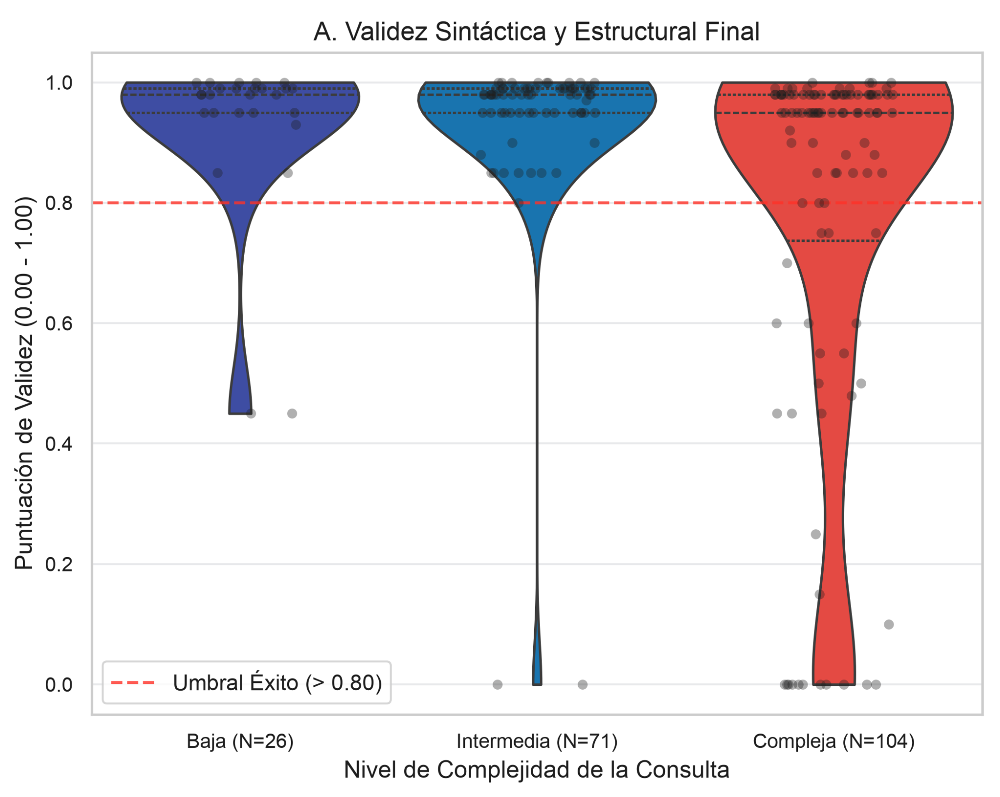

*Figure 12. Distribution of OMOP Agent Performance by Complexity Level. Panel A: Final Syntactic and Structural Validity Score. Dashed lines represent the thresholds for operational success (0.80) and perfect assignment (1.00).*

</div>

Non-parametric Kruskal-Wallis tests confirmed statistically significant differences across the three strata for both Syntactic Validity ($H = 23.61,\ p < 0.001$) and Terminological Precision ($H = 8.12,\ p = 0.017$). *Post-hoc* analysis revealed that performance in low and intermediate complexity does not differ significantly ($Z = 0.28,\ p_{\text{adjusted}} = 0.782$), whereas complex queries experience a significant drop compared to intermediate ($Z = 4.34,\ p_{\text{adjusted}} < 0.001$) and low complexity ($Z = 3.33,\ p_{\text{adjusted}} = 0.002$).

#### 4.2.2. Results by OMOP CDM Domain

Analyzing performance according to the primary table or domain of the OMOP CDM 5.4 model reveals substantial differences.

<a id="table-3"></a>
**Table 3.** *Agent Performance Stratified by Primary OMOP Domain.*

| Primary OMOP Domain | N (% total) | Mean Syntactic Validity (± SD) | Median Validity | Mean Vocabulary Precision | Mean Turns | Success Rate (> 0.80) |
| :--- | :---: | :---: | :---: | :---: | :---: | :---: |
| **`concept`** | 51 (25.4%) | 0.879 ± 0.194 | 0.950 | 0.975 | 2.140 | 0.824 |
| **`drug_exposure`** | 43 (21.4%) | 0.798 ± 0.355 | 0.980 | 0.956 | 2.230 | 0.791 |
| **`condition_era`** | 26 (12.9%) | 0.662 ± 0.387 | 0.850 | 0.795 | 2.580 | 0.577 |
| **`condition_occurrence`** | 23 (11.4%) | 0.945 ± 0.058 | 0.980 | 0.830 | 1.570 | 0.957 |
| **`drug_era`** | 20 (10.0%) | 0.821 ± 0.303 | 0.980 | 0.866 | 2.600 | 0.700 |
| **`observation_period`** | 20 (10.0%) | 0.931 ± 0.113 | 0.980 | 1.000 | 1.650 | 0.950 |
| **`person`** | 9 (4.5%) | 0.984 ± 0.005 | 0.980 | 1.000 | 1.220 | 1.000 |
| **`cost`** | 3 (1.5%) | 0.947 ± 0.045 | 0.950 | 1.000 | 2.330 | 1.000 |
| **`care_site`** | 2 (1.0%) | 0.975 ± 0.035 | 0.975 | 1.000 | 1.000 | 1.000 |
| **`payer_plan_period`** | 2 (1.0%) | 0.970 ± 0.028 | 0.970 | 1.000 | 1.500 | 1.000 |
| **`vocabulary`** | 2 (1.0%) | 0.965 ± 0.021 | 0.965 | 1.000 | 3.000 | 1.000 |

*Notes: N: Sample Size. SD: Standard Deviation. IQR: Interquartile Range. Min – Max: Minimum and maximum observed values. 95% CI Mean: 95% confidence interval for the mean.*

<a id="figure-13"></a>
<div align="center">

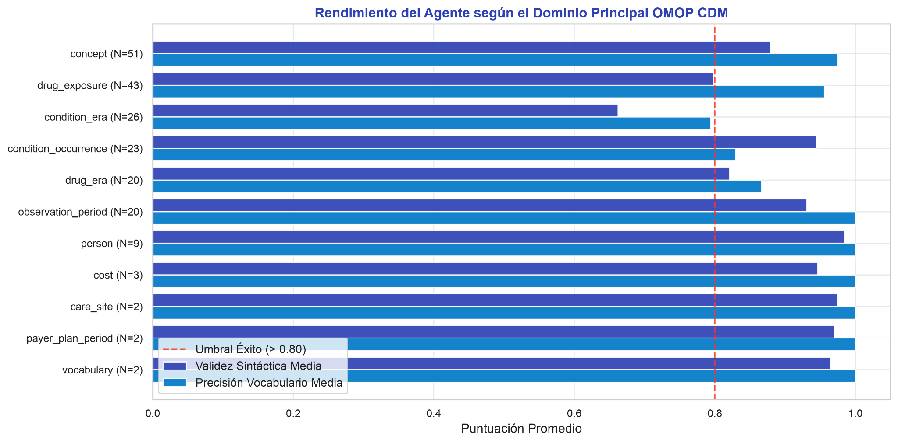

*Figure 13. Mean Performance of the Agent by Primary OMOP CDM Domain. Comparison between Mean Syntactic Validity and Vocabulary Terminological Precision against the 80% cutoff threshold.*

</div>

Differences in validity across domains were statistically significant (Kruskal-Wallis: $H = 15.65,\ p = 0.016$). Direct clinical event and demographic tables (`person`, `care_site`, `condition_occurrence`, `observation_period`) achieved exceptional success rates ($\ge 95.0\%$). Conversely, derived clinical persistence tables (*Eras*), and in particular `condition_era`, constituted the most challenging domain with a mean validity of only $0.662$ and a resolution rate of 57.7%.

Formal comparison between raw occurrence tables (`condition_occurrence`) and aggregated era tables (`condition_era`) revealed a statistically significant penalty in model performance (Mann-Whitney test: $U = 167.0,\ p = 0.0078$). This demonstrates that the agent readily interprets discrete diagnostic events, but struggles with the logic of continuous exposure or disease periods consolidated in `_era` tables.

#### 4.2.3. Results by Complexity Level and Resolution Turn

Evaluation results of the analytical agent across the 201-query benchmark show high vocabulary terminological precision (92.5%). Regarding SQL syntactic and structural validity, the system achieves a 23.9% success rate on the first turn, rising to an overall mean of 84.9% (and 81.6% operational success) after a conversational refinement process of up to three turns. While low- and intermediate-complexity queries were resolved very efficiently, complex queries require greater iterative effort, highlighting the challenges of automatic generation for advanced SQL.

<a id="table-4"></a>
**Table 4.** *Contingency Table: Complexity Level × Executed Conversational Turns.*

| Complexity Level (N, Row %) | Turn 1 | Turn 2 | Turn 3 | Total |
| :--- | :---: | :---: | :---: | :---: |
| **Low** | 12 (46.2%) | 7 (26.9%) | 7 (26.9%) | 26 (100.0%) |
| **Intermediate** | 20 (28.2%) | 38 (53.5%) | 13 (18.3%) | 71 (100.0%) |
| **Complex** | 16 (15.4%) | 40 (38.5%) | 48 (46.2%) | 104 (100.0%) |
| **Overall Total** | **48 (23.9%)** | **85 (42.3%)** | **68 (33.8%)** | **201 (100.0%)** |

*Notes: N: Sample Size. SD: Standard Deviation. IQR: Interquartile Range. Min – Max: Minimum and maximum observed values. 95% CI Mean: 95% confidence interval for the mean.*

<a id="figure-14"></a>
<div align="center">

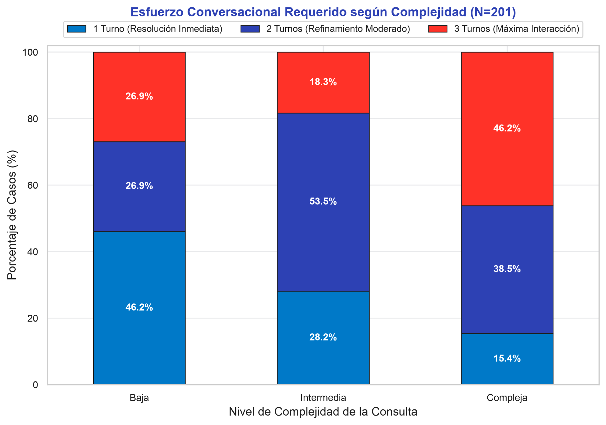

*Figure 14. Conversational Effort Required by Query Complexity ($N = 201$). Proportion of cases resolved in Turn 1 (direct resolution), Turn 2 (moderate refinement), and Turn 3 (maximum interaction).*

</div>

<a id="figure-15"></a>
<div align="center">

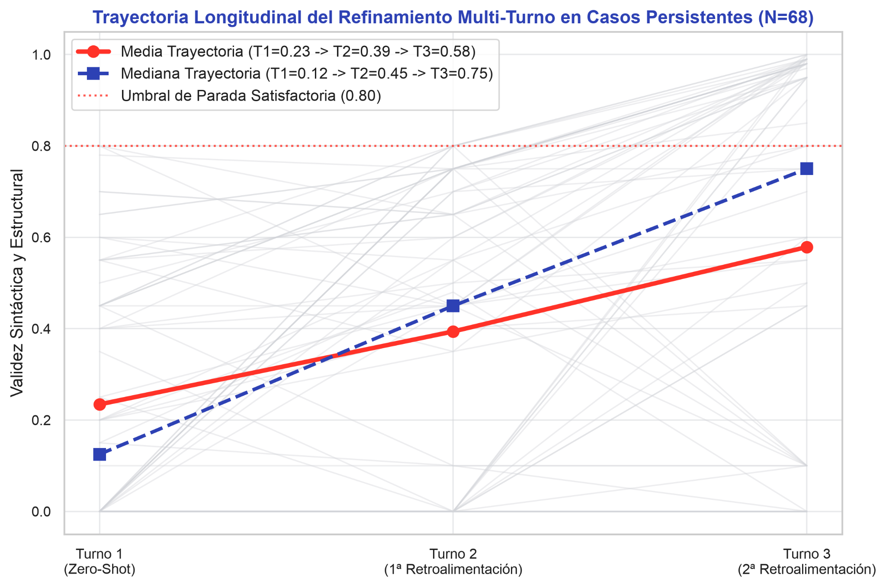

*Figure 15. Trajectory of result improvement across conversational turns.*

</div>

The test of independence confirmed a strong association between query complexity and the number of turns required ($\chi^2 = 23.11,\ p = 0.0001$). Whereas in low complexity nearly half of the cases (46.2%) were resolved immediately on the first turn (mean of $1.81 \pm 0.85$ turns), in high complexity only 15.4% were resolved on the first attempt (*zero-shot*), with 46.2% of queries requiring all three turns (mean of $2.31 \pm 0.73$ turns).

#### 4.2.4. Effect of Iterative Refinement

The contribution of guided dialogue to agent performance is quantitatively demonstrated in the cumulative resolution curve.

<a id="table-5"></a>
**Table 5.** *Performance Progression and Net Gain (Delta) by Turn.*

| Evaluated Transition | Cohort (N) | Initial Validity | Final Validity | Mean (Median) Validity Delta | Improved Cases (N, %) | Wilcoxon Test ($W, p$) |
| :--- | :---: | :---: | :---: | :---: | :---: | :---: |
| **Turn 1 → Turn 2** | 153 | 0.316 ± 0.318 | 0.708 ± 0.356 | +0.392 (+0.350) | 118 (77.1%) | $W = 264.0$, $p < 0.001$ |
| **Turn 2 → Turn 3** | 68 | 0.394 ± 0.352 | 0.579 ± 0.421 | +0.185 (+0.195) | 45 (66.2%) | $W = 247.5$, $p < 0.001$ |
| **Turn 1 → Final Consolidated** | **201** | **0.468 ± 0.369** | **0.849 ± 0.271** | **+0.381 (+0.340)** | **133 (66.2%)** | **$W = 0.0$, $p < 0.001$** |

<a id="figure-16"></a>
<div align="center">

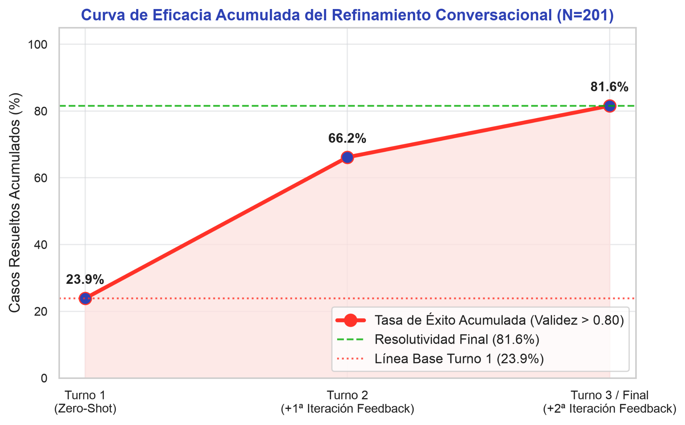

*Figure 16. Cumulative Efficacy Curve of Conversational Refinement ($N = 201$). Evolution of operational resolution rate ($\text{Validity} > 0.80$) from the initial Zero-Shot response to the third turn of interaction.*

</div>

Moving from a pure *zero-shot* interaction (Turn 1) to an interactive workflow increased the success rate from 23.9% ($48/201$) to 81.6% ($164/201$), representing an absolute net gain of $+57.7$ percentage points. We confirm that this jump in resolution rate is statistically significant ($\chi^2 = 114.01,\ p < 0.001$).

It is crucial to highlight that the mean validity score observed in Turn 3 ($0.579$) reflects a methodological *early stopping* effect (stopping threshold at $0.800$), whereby turn generation halts once that score is achieved: well-structured queries exited the loop in Turn 1 ($N = 48$, mean $0.954$) or Turn 2 ($N = 85$, mean $0.958$). Turn 3 thus isolated the 68 most challenging queries. Even within this difficult subgroup, the second feedback iteration effectively improved 66.2% of queries, raising the median from $0.45$ to $0.75$ (Friedman test $= 42.29,\ p < 0.001$).

---

## 5. Discussion

Analysis by complexity level and clinical domain reveals that the primary limitation of the system lies in resolving queries classified as complex.

### 5.1. Prompt Improvement

Forensic analysis of the 37 cases (18.4%) that did not surpass the operational stopping threshold ($> 0.80$) after the third interaction turn revealed a fundamental finding: the syntactic and semantic deviations observed did not stem from an intrinsic limitation in the reasoning capacity of the foundation model (Gemini-2.5-Flash), but rather from the absence of precise directives in the *System Prompt* of the SQL Constructor Subagent.

In the evaluated experimental framework, interactive conversational refinement effectively compensates for this gap starting in Turn 2, raising system resolution from the initial 23.9% to 81.6% consolidated. However, to minimize clinician conversational effort and maximize the first-turn (*zero-shot*) success rate, a set of priority clinical-architectural guidelines has been formalized for direct injection into the agent's execution instructions.

#### 5.1.1. Improvements to Implement in the OMOP Agent Instructions

- **Table selection: Raw events vs. Continuous episodes (Eras):** If the clinical requirement requests "continuous treatment episodes", "therapeutic persistence", or "disease duration", the agent must mandatorily use the derived clinical aggregation tables: `drug_era` or `condition_era`. Direct occurrence tables remain reserved exclusively for analyzing discrete dispensations, specific routes of administration, visits, or measurements.
- **Hierarchical expansion and vocabulary mappings (`concept_ancestor`):** To encompass aggregated diagnoses, clinical subtypes, or complete pharmacological families, the agent must mandatorily formulate hierarchical expansion via the ancestor table.
- **Integrity and filtering rules in OMOP catalogs:** In every query against the `concept` table, unless a specific historical study is requested, the condition `standard_concept = 'S' AND invalid_reason IS NULL` must be enforced as an invariant, mandatorily scoping the `domain_id` (e.g., `'Condition'`, `'Drug'`, `'Measurement'`) and `vocabulary_id` (e.g., `'SNOMED'`, `'RxNorm'`) fields.
- **Granularity and aggregation:** Requests for "number of patients" or "persons" must unfailingly translate to `COUNT(DISTINCT person_id)`, whereas "occurrences", "prescriptions", or "events" must use `COUNT(*)`.
- **Preservation of dynamic lexical searches:** When the user's intent is term exploration, the SQL query must be formulated using dynamic lexical filtering: `LOWER(concept_name) LIKE '%term%'` or `REGEXP_CONTAINS(LOWER(concept_name), r'...')`.
- **Modular structuring via Common Table Expressions (CTEs):** Every complex query or query involving multiple temporal aggregation stages must be organized using a single `WITH` structure, concatenating properly modularized CTE blocks with explicit, intuitive aliases.

#### 5.1.2. Expected Operational Benefit and Impact

Formally integrating these recommendations into the analytical agent's system instructions yields two direct quantitative advantages for system performance:

- **Drastic reduction in conversational effort (Turn 1 jump):** By eliminating at the root the systematic confusion between raw tables and era tables (*Eras*), as well as the unintended omission of taxonomic ancestors, it is projected that approximately 70 of the 153 queries that required iterative correction rounds in Turns 2 or 3 would be resolved successfully on the first turn (*zero-shot*). This would raise the system's initial resolution rate from the current 23.9% to estimated levels above **58%**.
- **Increase in Consolidated Mean Syntactic Validity:** By guaranteeing strict adherence to the database SQL dialect and OMOP vocabulary validity filters, overall Syntactic and Structural Validity would experience a quantitative leap from the current 84.9% to a projected range between **92% and 94%**, reducing the percentage of unresolved residual cases to under 8%.

Taken together, this contextual prompt-engineering refinement demonstrates that experimentally guided optimization can bridge the technical gap of the OMOP CDM standard with high efficiency, without needing to retrain the weights of the base language model or alter the modular subagent architecture.

### 5.2. Limitations in Evaluating Vocabulary Precision

Although Vocabulary Terminological Precision reached a high 92.5%, it should be noted that the test benchmark (*Gold Standard*) contains questions written with relatively direct and well-established clinical terms.

While this high precision reflects the proper functioning of the RAG architecture and validator subagent on standard concepts, when facing real-world clinical questions with greater syntactic ambiguity, infrequent synonyms, or imprecise clinical descriptions, terminological performance would likely face a substantially greater challenge.

### 5.3. Limitations Identified for Production Deployment

Assuming SQL generation and medical concept filtering are accurate, there remain clear challenges to overcome before deploying the solution in a production environment:

- **Diversity of Database Engines and Dialects:** Organizations using OMOP CDM employ highly diverse database systems (PostgreSQL, Oracle, SQL Server, Snowflake, Databricks, etc.). Production deployment would require creating a translator subagent and having target database instances available to validate the SQL before presenting it to the user.
- **Disconnection from Live Clinical Databases:** The agent's current workflow assumes the clinician queries the OMOP agent (a web application disconnected from the clinician's database) and the agent returns the SQL. The clinician must then copy the SQL and execute it in their own database environment, interrupting the seamless question-and-answer flow expected by the user.
- **Regulatory Compliance (GDPR / PII):** A clinician might inadvertently include personal data in their prompt; therefore, the system would need to detect this to either: (1) delete the prompt and ask the clinician to rephrase the question, or (2) strip the personal data before the question proceeds through the resolution pipeline. This check should also apply to the generated SQL to prevent it from containing personal data.

---

## 6. Conclusions and Potential Future Developments

### 6.1. Conclusions

I have validated the main hypothesis by proving that it is feasible to build an LLM-based conversational agent to translate natural language questions into SQL queries over the OMOP CDM standard, reducing reliance on technical teams for straightforward characterization analyses.

However, the need to interact iteratively with the agent to tailor the query to what we as clinicians actually want to search is evident. This is a clear indication that **while SQL generation ceases to be a barrier, the resulting query improves substantially based on the medical or clinical knowledge and experience of the user operating the agent**.

- **Effectiveness of the multi-agent approach with RAG, and the need to create a dedicated dataset to evaluate vocabulary performance:** Separation of concerns across subagents is key. Vocabulary localization demonstrated a remarkable 92.5% score, ensuring that the agent uses official standard codes from the OHDSI community. As discussed in the Discussion section, building a dedicated evaluation dataset with complex terminological challenges could stress-test the agent and yield a detailed roadmap of vocabulary improvements.
- **Identification of bottlenecks:** The overall Syntactic Validity (84.9%) and first-turn validity (23.9%) metrics demonstrate that while the system produces executable responses in 93.5% of cases (real technical execution) and resolves simple and intermediate questions effectively, automatic generation of complex SQL queries (15.4% syntactic validity on the first turn) is rarely resolved in a single iteration and consistently requires prompt corrections from the evaluator (or prospective clinical user).
- **Contribution to the SDGs:** The project lays the groundwork for democratizing access to biomedical data, directly contributing to reducing technical inequalities across healthcare institutions and accelerating observational data analysis (SDGs 3, 4, 9, and 10).

### 6.2. Potential Future Developments

As immediate short-term future developments, I would highlight:

- **Improvement of the agent's system prompt:** Incorporating the recommendations detailed in the section *[Improvements to Implement in the OMOP Agent Instructions](#511-improvements-to-implement-in-the-omop-agent-instructions)*.
- **Advanced support for concept hierarchies:** Incorporating rules so that the agent automatically injects the `CONCEPT_ANCESTOR` table whenever a medical question requires grouping diagnoses or drug families.
- **Evolution to ADK 2.0:** Migrating the current architecture to ADK 2.0 (*Agent Development Kit*) to leverage its new native orchestration management capabilities, enforcing mandatory passage through every validation stage without skipping steps.

In conclusion, although challenges remain in generating complex queries and integrating the system into production environments, this project demonstrates that combining multi-agent architectures with the OMOP CDM standard provides a viable and promising foundation for democratizing clinical OMOP data analysis in healthcare.

---

## 7. References

- Observational Health Data Sciences and Informatics (OHDSI). (2025). *2025 Journey*. https://www.ohdsi.org/wp-content/uploads/2025/10/OurJourney-2025.pdf
- Observational Health Data Sciences and Informatics (OHDSI) collaborative. (2021). *The Book of OHDSI*. OHDSI Community. https://ohdsi.github.io/TheBookOfOhdsi/
- Observational Health Data Sciences and Informatics (OHDSI). (n.d.). *Data standardization: OMOP Common Data Model*. https://www.ohdsi.org/data-standardization/
- Hripcsak, G. (2025, October 13). *State of the OHDSI community* [Presentation slides]. Observational Health Data Sciences and Informatics. https://www.ohdsi.org/wp-content/uploads/2025/10/OHDSI2025-Hripcsak-State-of-Community.pdf
- SNOMED International. (n.d.). *SNOMED CT: Systematized nomenclature of medicine clinical terms*. https://www.snomed.org/
- Observational Health Data Sciences and Informatics (OHDSI). (n.d.). *Achilles: SQL Server analyses* [Source code]. GitHub. https://github.com/OHDSI/Achilles/tree/main/inst/sql/sql_server/analyses
- Observational Health Data Sciences and Informatics (OHDSI). (n.d.). *QueryLibrary: OMOP CDM queries* [Source code]. GitHub. https://github.com/OHDSI/QueryLibrary/tree/master/inst/shinyApps/QueryLibrary/queries
- Observational Health Data Sciences and Informatics (OHDSI). (n.d.). *Athena: OHDSI vocabularies search*. https://athena.ohdsi.org/search-terms/terms
- Google. (n.d.). *Agent Development Kit (ADK) documentation*. Google Developers. https://adk.dev/

---

## 8. Annexes

- **GitHub:** https://github.com/sogire/tfm-ue-bioinformatica2526-agente-omop ([and annexes](https://github.com/sogire/tfm-ue-bioinformatica2526-agente-omop/tree/main/tfm-anexos))
- **Annex A:** Demonstration video of the agent in operation ([Link to Online Video](https://drive.google.com/file/d/1X5LAdfPPc92Amx8OGB7D8k7gLjz-4G9q/view?usp=sharing) | [Local File](Anexo-A_TFM_AgenteOMOP_Video-Demostracion.mp4)).
- **Annex B:** Agent system prompts ([`Anexo-B_TFM_AgenteOMOP_Prompts-sistema-agente.docx`](Anexo-B_TFM_AgenteOMOP_Prompts-sistema-agente.docx)).
- **Annex C:** List of evaluation questions and individual evaluation ([`Anexo-C_TFM_AgenteOMOP_Listado-preguntas-y-evaluacion-individual.xlsx`](Anexo-C_TFM_AgenteOMOP_Listado-preguntas-y-evaluacion-individual.xlsx)).
- **Annex D:** Aggregated quantitative evaluation results ([`Anexo-D_AgenteOMOP_Resultados-evaluacion-cuantitativa.xlsx`](Anexo-D_AgenteOMOP_Resultados-evaluacion-cuantitativa.xlsx)).

---

<div align="right">

*September 2026. Sergio Bermúdez Sánchez ([LinkedIn](https://www.linkedin.com/in/sergio-bermudez-sanchez/))*

</div>
